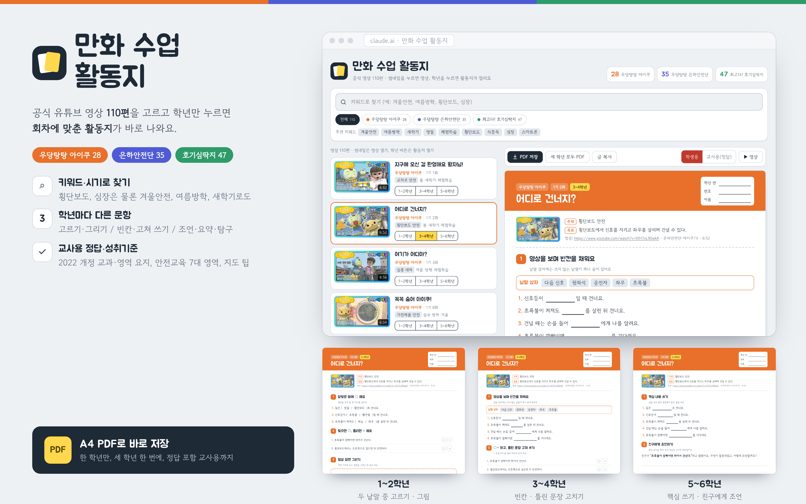

# 만화 수업 활동지

우당탕탕 아이쿠 · 우당탕탕 은하안전단 · 최고다! 호기심딱지 공식 유튜브 영상 110편의 회차별·학년별 수업 활동지입니다.

- 키워드·시기(겨울안전, 여름방학, 새학기 등)로 영상 찾기
- 1~2 / 3~4 / 5~6학년마다 다른 문항
- 교사용 정답, 관련 성취기준(2022 개정 교육과정 요지), 학교안전교육 7대 영역, 지도 팁
- A4 PDF 저장(한 학년 / 세 학년 묶음 / 교사용)과 바로 인쇄

## 알려 둘 점

- 활동지는 공식 채널의 회차 제목과 주제를 바탕으로 만들었습니다. 수업 전에 영상을 한 번 보고 낱말을 고쳐 쓰세요.
- 성취기준 코드와 원문은 국가교육과정정보센터(NCIC)에서 확인하세요.
- 영상과 썸네일의 저작권은 각 제작사와 방송사에 있습니다. 이 사이트는 영상을 링크로만 연결합니다.
